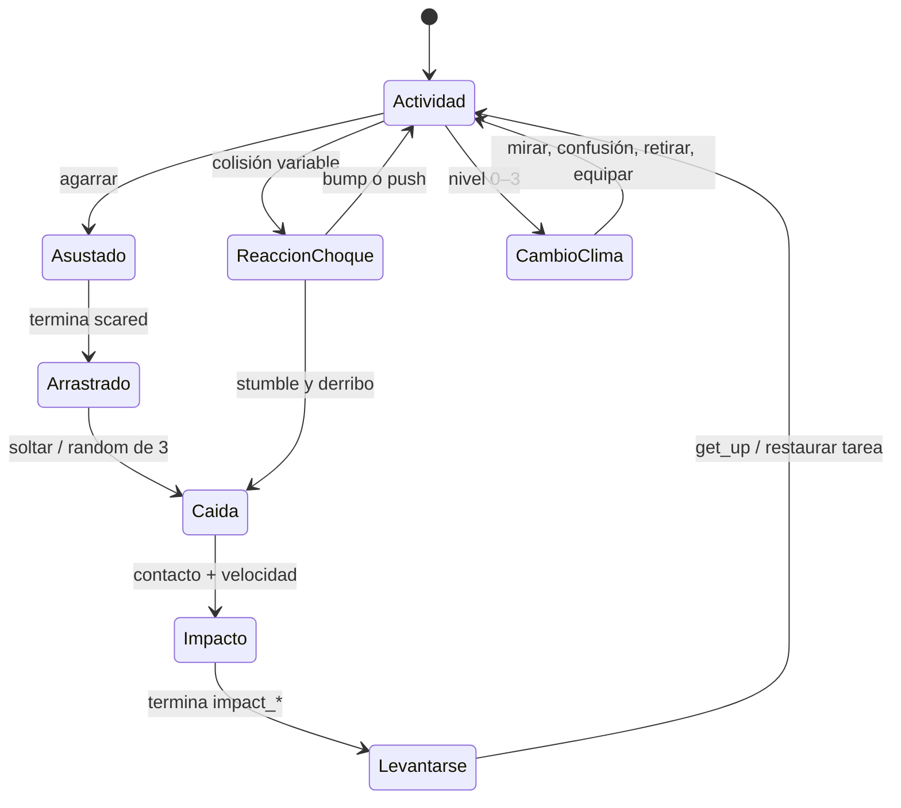

# Biblioteca visual del Home de Oziel

Guía de entrega para Claude · recursos 2D y ejemplos de integración en Phaser 3.

## 1. Qué se entrega y qué debe construir el integrador

Esta carpeta contiene imágenes reales, secuencias de fotogramas, atlases y fuentes editables para el portafolio de **Oziel Rodman Ramos Torrez**. Los personajes se reconstruyeron con un rig SVG articulado a partir de `reference/original_penguin.png`. Es una interpretación vectorial consistente de esa referencia, con las vistas nuevas necesarias para animarlo.

Los recuentos exactos, la cobertura y los resultados de las pruebas están en [production_report.md](production_report.md) y [qa_report.json](qa_report.json). El índice de todos los PNG, incluyendo los fotogramas individuales, está en [asset_manifest.json](asset_manifest.json). No hay que cargar todas esas copias en el navegador: para animar se cargan los atlases, junto con las capas y objetos necesarios para la escena activa.

El integrador construirá la página React, el diseño de contenidos, la coreografía final, la navegación accesible y las reglas de juego del Home. Los ejemplos de `integration/` son módulos y una prueba de funcionamiento; no constituyen el sitio terminado.

### Historia y restricciones

El ingeniero entra con **solo un casco**, observa el nombre suspendido, pulsa un interruptor y desaparece durante un apagón temporal. Al encender la luz reaparece. Llegan ayudantes, miran el nombre, transportan y montan una escalera, la sostienen, suben y cortan una cuerda. Cae el nombre completo; las letras rebotan y la O inicial de «Oziel» se integra en `hOme`. Conservar todos los pingüinos para el Home.

Desde el primer fotograma las cuerdas admiten clic o toque. Cortar cualquiera suelta **todas** las letras y acelera la transición. No crear un botón «Saltar intro». Las tijeras del visitante son un cursor; las del personaje son una herramienta temporal. La rama de la referencia se ha excluido del personaje.

Todos los pingüinos se pueden arrastrar durante intro y Home. Al agarrarlos miran de frente con ojos grandes y miedo leve; al soltarlos se selecciona al azar una de tres caídas. El impacto depende de la energía y continúa con recuperación y reanudación de la actividad recordada. Los choques pueden empujar, hacer tropezar o derribar, con variación y tiempo de espera entre reacciones.

El clima se controla solamente desde el Home. Niveles exactos: **0 invierno, 1 otoño, 2 primavera, 3 verano**. Otoño siempre tiene lluvia. Día/noche es un control independiente del clima y del apagón de la historia. No reiniciar personajes al cambiar el entorno.

## 2. Dónde está cada cosa

```text
assets_home_oziel/
  documento.md                  esta guía
  production_report.md          cobertura, decisiones y límites
  asset_manifest.json           todos los PNG reales con sus datos
  animations.json               secuencias ordenadas, FPS, origen y estados
  resources_catalog.md          tabla humana exhaustiva de imágenes
  animations_catalog.md         tabla humana de todos los clips y variantes
  qa_report.json                validación estructural y diagnóstico de ciclos
  reference/                    imagen recibida, hojas de modelo, paleta y brief
  characters/
    penguin/                    común, 71 acciones nominales
    engineer/                   casco, sin outfits estacionales
    penguin_winter/             bufanda integrada
    penguin_autumn/             botas y paraguas integrados
    accessories/                props independientes para interacciones
    [variante]/frames/[clip]/    PNG 256×256 de cada fotograma
    [variante]/clips/            tira horizontal de cada acción
    [variante]/atlases/          PNG y TexturePacker JSON Hash por grupo/página
  intro/                        cuerdas, escalera, interruptor, tijeras y efectos
  environments/
    [estacion]/day/              cinco capas 1920×1080
    [estacion]/night/            cinco capas 1920×1080
    [estacion]/props/            objetos y etapas de construcción
    [estacion]/particles/        partículas y efectos animados
    common/                     utilería ambiental compartida
  ui/                           niveles 0–3, sol/luna y cursores
  previews/                     hojas de contacto, GIF y visor HTML
  sources/                      fuentes SVG editables
  scripts/                      producción, ensamblado y validación
  metadata/                     metadatos de cada productor
  integration/                  módulos Phaser, notas y pruebas
```

Las rutas exactas prevalecen sobre este árbol resumido. Consultar `asset_manifest.json`, no deducir nombres a partir de este esquema. En el catálogo hay enlaces a cada imagen existente.

## 3. Modelo visual y medidas

Contorno continuo negro, curvas suavizadas, cuerpo carbón en forma de pera, cabeza unida al cuerpo, dos mechones, vientre gris claro, pico y patas ocre. El acabado es cartoon 2D plano con sombra simple. No es pixel art ni 3D. La referencia sigue disponible para comparar proporciones.

| Parte | Color de producción |
|---|---|
| Trazo | `#080c0b` |
| Cuerpo | `#373837` |
| Sombra del cuerpo | `#272927` |
| Vientre | `#d8d9d8` |
| Sombra del vientre | `#b8bab8` |
| Pico y patas | `#b9874c` |
| Casco | `#efb83d` |
| Bufanda | `#bb5547` |
| Botas | `#ba773d` |
| Paraguas | `#668681` |

La paleta completa está en `reference/style_palette.json`. Las hojas `character_model_sheet.png` y `engineer_model_sheet.png` muestran perfil izquierdo/derecho, frente, tres cuartos, espalda y tres expresiones. El perfil derecho puede resolverse con reflejo cuando `flipSafe` lo permita.

Los fotogramas son PNG RGBA de **256×256**, sin fondo pintado. El origen habitual es `(0.5,0.9)`; los clips aéreos pueden usar `(0.5,0.5)`. Leer siempre el origen del clip. El controlador de ejemplo compensa el cambio de origen para conservar la esquina del fotograma en el mundo. El suelo de referencia del personaje está cerca de y=230 en su celda. Una escala de .7 a 1 es adecuada en el mundo lógico 1920×1080; decidir el tamaño final por composición.

Dentro de las celdas aéreas el rig se reduce a .87 para dejar margen a giros y aletas; esta reducción ya está dibujada y no debe aplicarse una segunda vez en Phaser. El giro y los cambios de pose son parte del clip, mientras la trayectoria corresponde a la física.

El casco forma parte de cada fotograma del ingeniero y gira con el rig. No añadir otra capa de casco encima. La bufanda y las botas también se entregan compuestas en las variantes vestidas. Los props independientes sirven para equipar, quitar o soltar objetos, no para duplicar los accesorios ya dibujados.

## 4. Inventario de imágenes

[resources_catalog.md](resources_catalog.md) contiene la tabla completa: ID, archivo, tamaño, alfa real, tipo, variante, estación/luz y uso. [asset_manifest.json](asset_manifest.json) aporta además origen, escala recomendada, profundidad, dependencias y, en los atlases, celdas, columnas, filas y claves.

Los tipos de producción son `atlas`, `sprite`, `background`, `particle`, `prop` y `ui`. Los PNG de revisión o referencia llevan `preview`. Los GIF y HTML de revisión son herramientas de control y no se cargan en Phaser. `alpha:true` significa que hay transparencia real; los cielos opacos y el recurso de apagón se declaran sin ella.

Cada atlas tiene un JSON compañero con `frames` en formato hash, rectángulos sin recorte ni rotación, `sourceSize`, `spriteSourceSize`, `pivot` y `meta.image/size`. Los atlas de personaje se dividen en páginas de hasta 2048×2048 y ocho columnas, evitando una textura gigantesca. No extraer frames de las hojas de contacto: usar los atlas de producción.

Objetos principales de intro: `rope_intact`, `rope_taut`, `rope_cut_top`, `rope_fragment`, `anchor`, `ladder_complete`, `ladder_segment`, `ladder_foot`, `switch_on`, `switch_off`, sus variantes nocturnas, `scissors_tool`, `contact_shadow`, `frost_corner` y `frost_melt`. Cursores: `scissors_cursor` y `grab_cursor`; indicador táctil `scissors_touch`. Los detalles y puntos de interacción están en el manifiesto.

La escalera completa mide 160×512; origen inferior. Sus peldaños están espaciados 48px. La cuerda intacta mide 48×512 y su origen está arriba. El cursor mide 32×32; el punto activo de las tijeras es **(27,15)**. El icono táctil es independiente, de 96×96. Los cuatro controles estacionales tienen normal, hover, seleccionado y foco. Sol/luna tiene estados día y noche, con variantes visuales de hover y foco. Acompañar los iconos con etiquetas accesibles en HTML.

## 5. Inventario de animaciones

[animations_catalog.md](animations_catalog.md) enumera **cada variante y clip** con atlas, claves inicial/final, cantidad, FPS, repetición, origen, siguiente estado e interrupciones. La lista exacta y ordenada de claves está en [animations.json](animations.json); nunca generar rangos suponiendo que dos clips comparten página.

`repeat:-1` es bucle; `repeat:0` es una ejecución. `next`, `interruptible`, `notes`, `frameAnchors` y los datos de sincronización son metadatos de la aplicación: Phaser no ejecuta automáticamente esa máquina de estados. El módulo de ejemplo utiliza esos datos explícitamente. `durationMs` deriva de la cantidad y FPS, sin incluir pausas externas.

Las 71 acciones del inventario original están representadas en la variante común. Hay variantes vestidas de las acciones necesarias para continuar rutinas y físicas. El ingeniero omite las acciones exclusivas de ponerse o portar outfits que tiene prohibidos. No intentar reproducir `put_scarf` en un ingeniero: el controlador lo evita. Primavera y verano usan la base sin ropa; la crema es una acción temporal.

La diferencia entre las caídas es visible: `fall_normal` mantiene la orientación con balanceo leve; `fall_spin` rota y pasa por vistas de frente, lado y espalda; `fall_flap` mueve las aletas. El desplazamiento vertical de la caída se resuelve con física. El movimiento global de caminar, subir o nadar también corresponde al motor; los PNG contienen articulación local.

## 6. Cargar y reproducir con Phaser 3

Se verificó la API con Phaser **3.90.0**, versión fijada en la prueba. No presupone un import global dentro de los módulos. En una aplicación React, guardar manifiesto y configuración en un módulo o cargarlos en una escena Boot antes de crear la escena principal.

[integration/integration_notes.md](integration/integration_notes.md) amplía estos ejemplos con una escena de arranque completa, sincronización de props y referencias al código oficial de la versión probada.

Ejemplo mínimo que usa archivos y claves existentes:

```js
// Dentro de preload() de una Scene:
this.load.atlas(
  'penguin_base_00',
  '/assets_home_oziel/characters/penguin/atlases/penguin_base_00.png',
  '/assets_home_oziel/characters/penguin/atlases/penguin_base_00.json'
);

// Dentro de create():
this.anims.create({
  key: 'penguin:walk',
  frames: Array.from({ length: 8 }, (_, i) => ({
    key: 'penguin_base_00',
    frame: `walk_${String(i).padStart(3, '0')}`
  })),
  frameRate: 10,
  repeat: -1
});
const p = this.physics.add.sprite(450, 900, 'penguin_base_00', 'walk_000');
p.setOrigin(0.5, 0.9).setScale(0.8).setDepth(40).setFlipX(false);
p.body.setSize(108, 164, false).setOffset(74, 66);
p.play('penguin:walk');
p.setVelocityX(-55); // perfil base hacia la izquierda
```

Para la biblioteca completa usar las funciones verificadas, que comprueban las claves reales antes de registrar animaciones:

```js
import {
  preloadAssets, registerAnimations, registerEffectAnimations,
  PenguinController, EnvironmentController, connectPenguinCollisions
} from './integration/oziel_runtime.mjs';

// manifest, animations y environmentMetadata ya obtenidos en Boot.
// preload():
preloadAssets(this, manifest, '/assets_home_oziel');

// create():
registerAnimations(this, animations);
registerEffectAnimations(this, animations.effects);
const group = this.physics.add.group();
const first = animations.characters.penguin.idle;
const sprite = group.create(450, 900, first.atlasKey, first.frames[0]);
sprite.setScale(0.8).setDepth(40);
const controller = new PenguinController(this, sprite, animations);
connectPenguinCollisions(this, group);
this.controllers = [controller];
controller.setTask('walk', { velocityX: -55, flipX: false });

// update():
for (const c of this.controllers) c.update();
```

Configurar Arcade Physics con gravedad vertical, por ejemplo 950px/s², y una plataforma estática en la línea del suelo. El cuerpo propuesto es una aproximación de jugabilidad: no debe incluir el espacio transparente, el paraguas ni las aletas extendidas. Ajustarlo si cambia la escala o el diseño del suelo. No usar simultáneamente Matter y Arcade para el mismo cuerpo.

## 7. Estados, interrupciones y choques



`PenguinController` conserva la tarea previa (clip, velocidad y orientación), cancela oyentes antiguos al interrumpirse y admite que la intro actualice la tarea mientras el visitante sostiene al personaje. `scared` pasa a `dragged` mientras sigue pulsado; liberar activa gravedad y selecciona una caída con `Math.random`. Los umbrales de ejemplo son 330 y 650px/s de velocidad máxima: por debajo, impacto leve; después medio; arriba fuerte. Son parámetros de diseño para calibrar, no una simulación de lesiones.

La recuperación se encadena con eventos específicos `animationcomplete-<clave>` y no con temporizadores que asumen una duración. Los impactos convergen a una pose común para que `get_up` pueda comenzar sin corte. Mientras hay recuperación, no iniciar otra rutina automáticamente. El arrastre del visitante sí puede interrumpirla; se cancelan las esperas pendientes y después se vuelve a la tarea recordada.

`connectPenguinCollisions` toma velocidad relativa antes de la separación física. El ejemplo usa una probabilidad de derribo de .34 cuando la velocidad supera 90px/s y una espera de 650ms entre reacciones de un mismo personaje. Esto permite choques distintos y reacciones en cadena sin que todos caigan siempre. Los miembros del grupo deben tener controlador. Retirar los controladores con `.destroy()` al desmontar la escena React para evitar oyentes duplicados.

## 8. Objetos, construcción y la O de hOme

Los clips de transportar, colocar, montar, sostener y subir articulan al personaje; la escalera permanece como objeto separado. `frameAnchors` proporciona puntos transformados por fotograma (`handNear`, `handFar`, `neck`, `helmet`, `ground`) en coordenadas de la celda de 256px. El integrador coloca la escalera y ajusta el movimiento global para alinear aletas/patas con los peldaños. En `climb`, no reflejar arbitrariamente el sprite después de alinear las manos.

Los clips de nieve, castillo, flores, hojas y agua requieren sus props declarados en `notes`. Están producidas las etapas del muñeco de nieve y del castillo. Cambiar el objeto por la etapa siguiente en el punto de trabajo del clip; no repetir un bitmap bajo tres nombres. Las tijeras y la botella de protector aparecen únicamente durante su acción. La sombra es un sprite separado, que puede reducirse y atenuarse con la altura.

Ejemplo válido de seguir un punto de aleta en cada `animationupdate`; no añadir props que ya estén dibujados dentro del clip:

```js
function followAnchor(sprite, prop, definition, name = 'handNear') {
  const record = definition.frameAnchors.find(f => f.frame === sprite.frame.name);
  if (!record || !record[name]) return;
  const [ax, ay] = record[name];
  const localX = (sprite.flipX ? 256 - ax : ax) - sprite.originX * 256;
  const localY = (sprite.flipY ? 256 - ay : ay) - sprite.originY * 256;
  const point = sprite.getWorldTransformMatrix().transformPoint(localX, localY);
  prop.setPosition(point.x, point.y).setDepth(sprite.depth + 1);
}
```

Para las cuerdas, registrar `makeInteractiveRopes` **antes** de arrancar el reloj de la intro. `dropAll` es idempotente: un solo corte habilita la gravedad de todas las letras. `startIntroTimeline` ofrece los momentos narrativos y hooks para colocar la escalera, mover a los ayudantes y conectar las utilerías. La coreografía espacial final depende del encuadre elegido por el integrador; los hooks no colocan el escenario automáticamente.

```js
import {
  makeInteractiveRopes, createEditableName, formHomeFromLetters,
  createBlackout, startIntroTimeline
} from './integration/oziel_runtime.mjs';

const letters = createEditableName(this);
const rope = this.add.image(650, 35, 'rope_intact').setOrigin(0.5, 0).setDepth(55);
const blackout = createBlackout(this);
let timeline;
const ropes = makeInteractiveRopes(this, [rope], letters, {
  cursorURL: '/assets_home_oziel/ui/scissors_cursor.png',
  onCut: () => {
    timeline?.cancel();
    blackout.reset();
    rope.setTexture('rope_cut_top');
    this.time.delayedCall(1200, () => {
      formHomeFromLetters(this, letters, { onReady: () => showHomeControls() });
    });
  }
});
// engineer y helpers son PenguinController existentes; todos se conservan.
timeline = startIntroTimeline(this, { engineer, helpers, ropes, blackout, hooks });
```

En ese fragmento, `showHomeControls` y `hooks` son funciones de la página anfitriona, expresamente a definir; las API de Phaser y los helpers importados son reales. Añadir collider de las letras con la plataforma para ver rebotes. Ajustar el retraso de 1200ms a la distancia de caída, o detectar reposo antes de formar el título. `formHomeFromLetters` reutiliza la O real del nombre. Mantener también el nombre y `hOme` en HTML semántico para lectura asistida y edición; el bitmap de referencia tipográfica no debe sustituir el texto de la página.

El apagón utiliza una capa temporal; no cambia la variable permanente de día/noche. Al cortar anticipadamente, cancelar su animación y despejar la capa para no ocultar el Home.

## 9. Estaciones y día/noche

Hay cinco capas separadas por combinación: `sky`, `far_background`, `midground`, `ground`, `foreground`, todas de 1920×1080. El orden y profundidad están declarados en los metadatos. La línea de apoyo recomendada es **y=900**. Los objetos interactivos van sobre el suelo; los personajes a profundidad 40, el primer plano a 60 y los efectos de clima sobre ellos, conservando legibilidad.

| Nivel | Estación | Día / noche | Partículas y objetos | Preparación del común |
|---:|---|---|---|---|
| 0 | winter | ambas | nieve, hielo, escarcha, bolas y muñeco por etapas | bufanda |
| 1 | autumn | ambas | lluvia continua, hojas, charcos, ondas y splash | botas y paraguas |
| 2 | spring | ambas | flores, hierba, pétalos, mariposas articuladas | sin outfit |
| 3 | summer | ambas | playa, mar, olas, espuma, arena y castillo por etapas | aplicar protector |

```js
const environment = new EnvironmentController(this, manifest, environmentMetadata);
environment.set(2, false); // primavera de día
async function chooseSeason(level) {
  environment.set(level, environment.night);
  await Promise.all(controllers.map(c => c.changeWeather(level)));
}
function toggleDayNight() {
  environment.set(environment.level, !environment.night);
}
```

El controlador cambia las capas con una mezcla de 400ms, mantiene a los mismos personajes y conserva el emisor de lluvia al alternar día/noche en otoño. Al cambiar la estación puede sustituir el emisor; mantener lluvia durante todo el tiempo en que el nivel activo sea 1. Los fotogramas de gotas, copos, hojas y pétalos son partículas; desplazar, rotar y emitir en ejecución. El ciclo `summer_wave` es repetible horizontalmente; sus bordes laterales son intencionales, no recorte accidental. Mariposa y olas tienen claves `effect:<nombre>` al registrarse con `registerEffectAnimations`.

Los tiempos, densidades, fuerzas del viento y frecuencia de actividades del ejemplo son propuestas configurables. En móvil reducir el número de partículas antes de sacrificar los clips del personaje. Cargar únicamente las temporadas necesarias y liberar texturas no usadas cuando se conozca la estrategia de navegación; el cargador de demostración carga toda la biblioteca para verificarla.

## 10. Accesorios y cambio de vestuario

El ingeniero usa `engineer` en todas las estaciones y conserva únicamente el casco. Puede tiritar, jugar con nieve, construir, nadar o aplicarse protector sin recibir bufanda, botas ni paraguas.

El común usa `penguin_winter` para invierno, `penguin_autumn` para otoño y `penguin` para primavera/verano. Antes de cambiar: pausar actividad, `notice_weather`, `weather_confused`, `remove_accessories` si procede, cambiar la variante del mismo sprite, ejecutar equipamiento y `resume_after_weather`. El módulo hace la secuencia y recuerda la actividad. Si el personaje está agarrado, cayendo o recuperándose, encola la estación más reciente.

Bufanda, botas y casco están transformados dentro del mismo rig, sin anclajes flotantes. El paraguas se retira o pliega en poses aéreas y de impacto para mantener el personaje dentro de 256px. Usar el prop plegado para el objeto que se suelta, y restaurar la variante vestida al acabar la recuperación. No añadir el paraguas abierto como capa encima de un fotograma que ya lo contiene. Los movimientos de equipamiento usan articulación y cambios de visibilidad/escala de las piezas; no son una simulación de tela.

Consultar `metadata/characters.json` para notas de cada variante y `frameAnchors` para utilería temporal. Los perfiles, el paraguas y la escalera tienen asimetrías que hacen necesario respetar `flipSafe` y comprobar la alineación de los objetos antes de reflejar un clip.

## 11. Adaptación a móvil y acceso táctil

Usar un mundo lógico consistente y adaptar la cámara o recomponer las capas. No escalar 1920×1080 a un teléfono hasta hacer diminutos los personajes. En vertical, recortar el cielo/fondo con `cover`, mantener la franja del suelo y reubicar árboles, utilería y controles; los objetos sueltos permiten esa composición. Evitar que el horizonte y la playa desaparezcan por un recorte excesivo.

Las cuerdas se entregan delgadas pero su zona de toque debe medir al menos **44px de pantalla**. Si la cámara está escalada, convertir ese mínimo a unidades de mundo: `44 / camera.zoom`. El helper ensancha a 44 unidades de fuente; el integrador debe aplicar la corrección por zoom para cada pantalla. El indicador de tijeras aparece junto al toque/selección. Los eventos de arrastre de Phaser admiten puntero y touch; impedir desplazamiento accidental de la página solo dentro del canvas interactivo mediante `touch-action:none`.

Ofrecer controles HTML accesibles de clima y luz, nombre y título semánticos, foco visible y texto alternativo. Respetar `prefers-reduced-motion`: permitir una transición breve al Home sin crear un botón de salto contrario al encargo, y reducir efectos ambientales desde las preferencias del sistema. No inventar biografía, enlaces o redes sociales.

## 12. Revisar y volver a generar

Abrir [previews/animation_review.html](previews/animation_review.html) para revisar los clips de los atlas finales, elegir variante, pausar y variar velocidad. Funciona leyendo imágenes locales; el JSON necesario está integrado. Las hojas de contacto por atlas y los GIF están en `previews/`. Ver los ocho ambientes juntos en [previews/environments_all_eight.png](previews/environments_all_eight.png).

Los scripts de producción son deterministas. Requieren Node.js con `sharp` y Python con Pillow. En este equipo usan las dependencias de trabajo ya instaladas; en otro equipo ajustar la importación de Sharp o instalarla y usar `require('sharp')`.

```text
node scripts/build_characters.cjs
node scripts/build_environments.cjs
node scripts/build_intro_ui.cjs
python scripts/build_environments_validate.py
python scripts/assemble_library.py
node integration/runtime_test.mjs
node integration/test/run_browser_test.cjs
```

No regenerar mientras se ejecuta el ensamblador o una prueba de navegador: esperar a que termine cada productor. El ensamblador reconstruye manifiestos/catálogos/visor y valida existencia, tamaños, RGBA, celdas, claves y movimiento no estático. `qa_report.json` registra cantidad de fotogramas únicos y diferencias entre pasos de los bucles. Los fotogramas repetidos por simetría o una pausa dentro de una acción no equivalen a un clip estático; los clips totalmente estáticos se consideran error.

Las pruebas de navegador levantan un servidor local temporal y usan Phaser 3.90.0 fijado. El módulo de prueba y su captura están en `integration/test/`. El estado final de esas pruebas está documentado en el informe de producción. Revisar también continuidad, silueta, poses y legibilidad visualmente: un esquema JSON válido no prueba por sí solo la calidad artística.

## 13. Límites y pasos de integración

Las imágenes y secuencias entregadas existen; no son prompts pendientes. La reconstrucción conserva el lenguaje visual de la referencia, pero las vistas frontales y traseras son interpretaciones nuevas. Es animación de rig 2D, con deformaciones simples y poses muestreadas. No se promete animación tradicional dibujada a mano ni equivalencia exacta con la foto en cada ángulo.

La cobertura nominal de los 71 clips se informa separada de la coreografía final del sitio. Escalera, construcción por etapas, cuerda, letras físicas y utilerías requieren montaje espacial y sincronización con los puntos/eventos entregados. Los módulos de ejemplo cubren interacciones y estados, pero el integrador debe escoger posiciones, rutas, tiempos definitivos, distribución responsive, actividades aleatorias y contenidos reales.

El ciclo de giro cambia de vista por poses discretas; revisar la cadencia en el contexto final. Los bucles y transiciones no deben evaluarse solamente por nombres o recuentos. Las restricciones y resultados de QA concretos están en `production_report.md`, junto con cualquier asunto pendiente. No describir el Home web como implementado por el hecho de que la biblioteca esté producida.

Referencias técnicas consultadas: [carga de atlas](https://docs.phaser.io/api-documentation/class/loader-loaderplugin#atlas), [animaciones](https://docs.phaser.io/phaser/concepts/animations), [entrada y arrastre](https://docs.phaser.io/phaser/concepts/input), [Arcade Physics](https://docs.phaser.io/phaser/concepts/physics/arcade), [partículas](https://docs.phaser.io/phaser/concepts/gameobjects/particles). Los enlaces y comprobaciones específicas adicionales están en las notas de integración.
